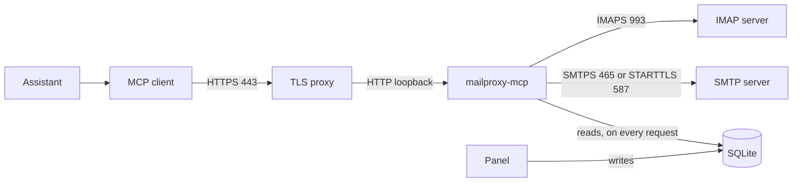

# mailproxy-mcp

**An [MCP](https://modelcontextprotocol.io) server that gives AI assistants access
to third-party IMAP/SMTP mailboxes. Write operations require human authorization.**
Automated routines can use opt-in direct sending.

The assistant speaks MCP over HTTP. The mailbox stays on its existing IMAP/SMTP
server, which retains responsibility for mailbox administration, message storage,
and access policy.

## Why it exists

Many agents can reach the Internet only over HTTPS on port 443. They cannot
connect directly to a mailbox using IMAP (993) or SMTP (465 or 587).

mailproxy-mcp runs on your own server. The assistant's client connects to it over
HTTPS, and mailproxy-mcp uses IMAP and SMTP from a network that can reach the
mailbox. The server keeps the mailbox password. The client presents a bearer
token.

## Scope

**Supported operations**

- List, search, and read messages and attachments, group threads, and find
  unanswered messages.
- Send messages, mark them as read or unread, delete them, and save drafts after
  explicit confirmation from the person operating the assistant. Automated
  routines can use direct sending when they have prior authorization.
- Isolate mailboxes. `/mcp/<account>` exposes one mailbox with its own credential.
  `/mcp/<domain>` exposes the accounts in a domain.
- Manage accounts in a web dashboard on a separate port and make them available
  without restarting.

**Operational limits**

- Mailbox administration, folder creation, filtering, forwarding, and scheduled
  sends are outside the server's scope.
- Each operation opens an IMAP connection, performs its work, and closes it.
  There is no local message cache or mailbox replica. The server persists the
  audit log, account configuration, and direct-send idempotency keys.
- Sending and receiving mail remain the responsibility of the upstream mail
  servers.
- Authentication uses a static bearer token. OAuth is unsupported.
- Run **a single worker**. Confirmation IDs and the daily send quota live in
  memory. Direct-send idempotency keys live in the database.

## Features

- Read over IMAP with `EXAMINE` and `BODY.PEEK`. Listing, searching, and reading
  leave message read status unchanged.
- Send over SMTP (`ssl` on port 465 or `starttls` on port 587), with reply headers
  (`In-Reply-To` / `References`), attachment limits, and a copy in Sent with
  blind-copy recipients removed.
- Mark messages as read or unread, move them to Trash, and save drafts.
  Permanent deletion must be requested during preparation.
- Each write capability has a global switch and optional domain and account
  permissions managed in the dashboard. The global switch must be enabled for
  the tool to register. Domains inherit the global setting and accounts inherit
  their domain's setting unless overridden. Direct sending has its own switch
  and permission.
- Sending and deleting use two-step confirmation. A `confirmation_id` lasts
  10 minutes, can be used once, and is bound to the account and operation.
- Optional direct sending for automated routines uses one call, with
  idempotency enforced by `idempotency_key`.
- Store multiple accounts by domain in a database. Passwords are encrypted
  with a key held outside the database.
- Separate credentials for each account and domain limit access to their
  respective scopes. The global credential works across all routes.
- Use the dashboard's separate port to add accounts, domains, and tokens,
  test connections before saving, and see updates in `/mcp` immediately.
- Audit each call in JSONL without logging message bodies or credentials.
- Streamable HTTP transport with a single uvicorn worker.
- Deploy with Portainer using a single `.env` for configuration.

## Tools

Read tools are always available. A write tool is available when its global
switch is `true` and at least one account allows it.

| Tool | Mode | Enablement |
| --- | --- | --- |
| `list_accounts` | Read | Always |
| `list_folders` | Read | Always |
| `list_messages` | Read | Always |
| `search_messages` | Read | Always |
| `get_message` | Read | Always |
| `get_attachment` | Read | Always |
| `find_unanswered` | Read | Always |
| `list_threads` | Read | Always |
| `prepare_send` | Prepare a send | `enable_send` and `allow_send` |
| `send_message` | Write | Same permissions plus `confirmation_id` |
| `send_message_direct` | Write with prior authorization | `enable_direct_send` and `allow_direct_send` |
| `mark_read` | Write | `enable_mark` and `allow_mark` |
| `mark_unread` | Write | `enable_mark` and `allow_mark` |
| `prepare_delete` | Prepare a deletion | `enable_delete` and `allow_delete` |
| `delete_message` | Write | Same permissions plus `confirmation_id` |
| `create_draft` | Write | `enable_drafts` and `allow_drafts` |

### Arguments can also be passed as strings

Pass arguments in their native types or as strings: `limit: 20` or `"20"`,
`uids: [21055]` or `"21055,21051"`, and `unseen: true` or `"true"`. The
server normalizes the inputs and reports invalid values in the error. UID
lists also accept strings for individual values: `["21055", "21051"]`.

This supports MCP bridges such as OpenMausBot that validate arguments without
type coercion and would otherwise reject strings before they reach the server.
Argument names remain compatible with clients that already have the catalog.

### Finding a sent message

`send_message` returns the information needed to find the message.

| Field | Meaning |
| --- | --- |
| `sent: true` | The SMTP server accepted the message. |
| `message_id` | The Message-ID from the message header. |
| `sent_uid` | The UID assigned to the copy in Sent, if the server provided one. |
| `sent_folder` | The folder where the copy was saved. |
| `copy_in_sent` | Whether the server was able to save a copy. |

Search by `message_id`:

```text
search_messages(folder=<sent_folder>, message_id=<message_id>)
```

Read the message directly when `sent_uid` is available:

```text
get_message(folder=<sent_folder>, uid=<sent_uid>)
```

`list_accounts` also reports `sent_folder` and `drafts_folder` for each account.
`create_draft` returns `message_id` and `draft_uid` for the new draft.

Call `list_accounts` first. It reports the current route's scope and returns
the catalog of account and domain routes.

`prepare_send` returns a preview and a `confirmation_id`. `send_message`
accepts only the account and that `confirmation_id`, so recipients and subject
are fixed after preparation. For deletion, set `permanent` in `prepare_delete`.
It is carried in the `confirmation_id`. Marking a message takes effect
immediately and is audited. `create_draft` saves the message in Drafts.

### Two-step sending

Preparation returns a preview. Sending requires a separate tool call.

```text
prepare_send → preview + confirmation_id        (does not send)
   ↓ show the preview and wait for the explicit order
send_message(confirmation_id)                    (sends)
```

The workflow is documented in three places.

- **Server instructions** describe the workflow step by step.
- **Tool descriptions** explain that `prepare_send` produces the preview and
  identify the next call. `send_message` specifies where to get the
  `confirmation_id`.
- **The preparation response** includes a notice and the machine-readable
  fields `status: "prepared"`, `sent: false`, and `next_tool: "send_message"`.

Deletion uses the same workflow with `prepare_delete` and `delete_message`.

The second call returns `status: "sent"` and `sent: true` only after the
SMTP server accepts the message. If the `confirmation_id` has expired, has
already been used, or was unreadable, prepare the operation again to obtain a
new one.

### Direct sending for automated routines

Two-step sending requires human authorization for every message. Some
scheduled routines, for example those in Paperclip, can make a single tool
call and therefore cannot complete both steps.

`send_message_direct` sends the full message from the arguments in **one call
with prior authorization**. There is no `confirmation_id`.

Direct sending is opt-in and has independent permissions.

| Mode | Global switch | Permission |
| --- | --- | --- |
| Sending with confirmation | `MCP_ENABLE_SEND` | `allow_send` |
| Direct sending | `MCP_ENABLE_DIRECT_SEND` | `allow_direct_send` |

An account can enable either or both methods. Set domain and account
permissions in the dashboard and the global switches in the environment.

The tool requires an `idempotency_key`, a stable identifier for the send, such
as the ID of the Trello item that prompted it. Repeating a call with the same
key and content returns the previous result with `duplicate: true`. Reusing
the key with different content is rejected.

The database stores the key across restarts, so retrying after a restart does
not send the email twice.

### Handling send failures

Check the SMTP outcome before retrying to avoid sending a duplicate.

| Situation | Server behavior | Agent action |
| --- | --- | --- |
| SMTP **rejects** the send, for example because of an invalid recipient or server policy | Releases the key. | Retry with the same key. |
| SMTP **does not respond**, for example because the connection dropped | Leaves the key in an **uncertain** state. The message may have been sent. | Check Sent before attempting another send. Use a new key only after confirming the message was never sent. |
| The call **is repeated** with the same key and content | Returns the previous result with `duplicate: true`. | No action required. |

Example call on the account route:

```json
{
  "name": "send_message_direct",
  "arguments": {
    "to": ["destinatario@example.com"],
    "subject": "Pending Trello-42",
    "body": "Details of the pending item.",
    "idempotency_key": "trello-42"
  }
}
```

Direct sending uses authorization granted in advance. Limit the permission to
the account used by the automated routine.

### Why the field is named `confirmation_id`

Some platforms redact tool response fields by **name** before returning them
to the model. Paperclip redacts names that resemble credentials (`token`,
`secret`, `password`, `api_key`, `bearer`, `authorization`, and others).
Its `validateToolContent` passes along the redacted value.

With `confirm_token`, the agent received `***REDACTED***` and could not complete
the send or determine why it failed. Redaction depended on the field name.

`confirmation_id` avoids that pattern, so the value reaches the agent intact.
The ID requires the account's bearer token and is valid for one operation on
one account for ten minutes. Its `cfm_` prefix avoids provider credential
patterns.

`tests/test_nombres_de_campos.py` enforces this rule. MCP field names must avoid
secret patterns. If a value arrives redacted, the error identifies redaction
instead of reporting an unknown or already-used ID.

## Routes

| Route | Scope | What the client sees |
| --- | --- | --- |
| `/mcp` | The default domain, if configured | The route catalog and any accounts in the default domain. |
| `/mcp/<domain>` | Accounts in that domain | Multiple accounts. |
| `/mcp/<account>` | One account | The mailbox for that account. |

`/mcp` is the entry point. `list_accounts` returns the routes for each account
and domain. Use the appropriate route to access a mailbox.

`<account>` can be the email address, account name, or account index.

Use the most specific credential for the requested scope.

| Credential | Access | Valid routes |
| --- | --- | --- |
| `MCP_BEARER_TOKEN` (global) | All accounts | All routes |
| Domain credential | Accounts in that domain | `/mcp/<domain>` and its account routes |
| Account credential | One account | `/mcp/<account>` |

The credential must authorize the route. An account credential is limited to
its account route. A domain credential is limited to routes within its domain.

Each route restricts the set of accounts a tool can access. One check in the
code enforces that isolation, so knowing another account's identifier does not
grant access to it.

On a single-account route, the tool's `account` argument is optional because
the route identifies the account.

## Dashboard

The web dashboard runs on a **separate port** and lets you add accounts without
changing the deployment. Accounts are stored in SQLite and grouped by domain.
New accounts become visible in `/mcp` without a restart.

The dashboard has its own credential, session, and CSRF protection. It manages
configuration and tests connections. Mailbox reads and writes are handled by
the MCP server.

See [docs/dashboard.md](docs/dashboard.md).

## Security

- **Bearer authentication.** `MCP_BEARER_TOKEN` is required and must be at
  least 16 characters long. The server compares SHA-256 hashes with
  `hmac.compare_digest`. `/mcp` returns 401 without a token. The container
  health probe, `GET /health`, returns `{"status":"ok"}` without mailbox data.
- **Account and domain credentials.** Account credentials are scoped to their
  account routes. Domain credentials cover their domain's accounts. Each
  credential must be unique and distinct from the global bearer token.
- **Encrypted passwords.** Account passwords are encrypted with AES-GCM and
  `MCP_DASHBOARD_KEY`, which is stored outside the database. Losing the key
  makes the passwords unrecoverable.
- **Dashboard isolation.** The dashboard manages configuration. Mailbox tools
  are available only through the MCP server.
- **Read-only by default.** `MCP_ENABLE_SEND`, `MCP_ENABLE_MARK`,
  `MCP_ENABLE_DELETE`, and `MCP_ENABLE_DRAFTS` default to `false`. Manage
  domain and account permissions in the dashboard. A switch accepts only
  `true`, `false`, `1`, and `0`. For example, `"false"` disables a capability,
  and `"yes"` stops startup with a configuration error.
- **Two-step confirmation.** Sending and deleting take effect on the second
  call. Each `confirmation_id` expires, can be used once, and is bound to its
  account and operation. The daily quota counts only SMTP-accepted sends.
- **Audit log minimization.** Each line records time, tool, account, and a
  subset of arguments such as recipients or UID, subject, and filenames.
  Message bodies, attachments, `confirmation_id` values, and passwords are
  excluded. If the line cannot be written, the tool leaves the mailbox
  untouched and does not issue a `confirmation_id`.
- **Prompt injection.** Subjects, bodies, and attachment filenames are
  untrusted. The server instructs assistants to call `send_message` or
  `delete_message` only after explicit authorization from the operator in
  the current conversation, after showing the preview.
- **Network.** The process binds to `127.0.0.1` by default. Other binds require
  `MCP_ALLOW_NONLOCAL_BIND=1`. `allowed_hosts` and `allowed_origins` protect
  against DNS rebinding. Terminate TLS at a proxy for public exposure.
  Use one worker because confirmation IDs and the quota live in memory
  and are lost on restart.

See the [deployment security checklist](docs/security.md).

## Architecture



The assistant needs only port 443 to reach the proxy. mailproxy-mcp connects
to IMAP and SMTP from a machine that can reach the mailbox. Reads use
`EXAMINE`. Write operations open the folder in read-write mode only while
they need it. The account username is used as the `From` address.

With Cloudflare Tunnel, the Cloudflare edge terminates TLS and `cloudflared`
connects to the container over plain HTTP on the Docker network. Caddy is
unnecessary in this configuration.

The dashboard is a second HTTP server **in the same process**, on another
port. It shares the database and audit log. It has no MCP tools or mailbox
access.

## Usage

Configure the server through the environment. Manage domains and accounts
through the dashboard.

### Startup

The dashboard requires two secrets in addition to the MCP bearer token.

```bash
python3 -m venv .venv
.venv/bin/pip install -r requirements.txt
export MCP_BEARER_TOKEN="$(openssl rand -base64 48)"   # the assistant
export MCP_DASHBOARD_KEY="$(openssl rand -base64 48)"   # encrypts the passwords
export MCP_DASHBOARD_TOKEN="$(openssl rand -base64 48)" # opens the panel
export MCP_AUDIT_LOG=./audit.jsonl
.venv/bin/python server.py
```

The database defaults to `./cuentas.db` and can be set with
`MCP_DASHBOARD_DB`. Use a persistent location, such as the data volume
inside the container.

| Interface | Port | Credential | Purpose |
| --- | --- | --- | --- |
| MCP | 8765 | `MCP_BEARER_TOKEN` | Assistant requests |
| Dashboard | 8766 | `MCP_DASHBOARD_TOKEN` | Account and domain management |

The MCP endpoint is `http://127.0.0.1:8765/mcp`. The dashboard is at
`http://127.0.0.1:8766`. See [configuration](docs/configuration.md) for the
full list of variables.

### Add an account

1. **Open the dashboard** at `http://127.0.0.1:8766` using `MCP_DASHBOARD_TOKEN`.
2. **Create a domain**, for example `corp.example.com`. It groups accounts
   and can provide default IMAP and SMTP settings.
3. **Enter the account details** within the domain and test the connection
   before saving. The test will identify invalid hosts, ports, or passwords.
4. **Save the account.** The dashboard encrypts and stores its password.
   Copy the generated token, which the dashboard shows once.
5. **Check the account.** `/mcp/<account>` is available on the next request
   without a restart. `list_accounts` includes it in the catalog.
6. **Set the client** to the desired route and provide its credential:

   ```bash
   https://mcp.example.com/mcp/ada@corp.example.com
   Authorization: Bearer <the account token>
   ```

7. **Set a default domain** to expose its accounts on `/mcp`. Without a
   default domain, `/mcp` provides only the route catalog.

The server uses the database as the source of accounts. The dashboard
manages the configuration and tests connections. See
[docs/dashboard.md](docs/dashboard.md).

### Docker

```bash
export MCP_BEARER_TOKEN="$(openssl rand -base64 48)"
export MCP_DASHBOARD_KEY="$(openssl rand -base64 48)"
export MCP_DASHBOARD_TOKEN="$(openssl rand -base64 48)"
docker compose -f docker-compose.yml -f docker-compose.local.yml up --build
```

Add accounts through the dashboard after startup. Compose does not declare
accounts. When `MCP_IMAGE` is unset, Compose builds `mailproxy-mcp:local`
locally.

The base Compose file mounts the `data` volume at `/var/lib/mcp-correo`
for the database. The container's read-only filesystem requires this
volume to persist accounts across restarts.

## Configuration

The configuration comes from environment variables. See the
[configuration reference](docs/configuration.md) for types, defaults,
and validation errors.

```bash
# The secret the MCP client presents. Required, at least 16 characters.
export MCP_BEARER_TOKEN="$(openssl rand -base64 48)"

# Panel credentials: keep them, especially the encryption key.
export MCP_DASHBOARD_KEY="$(openssl rand -base64 48)"
export MCP_DASHBOARD_TOKEN="$(openssl rand -base64 48)"
```

| Variable | Purpose |
| --- | --- |
| `MCP_BEARER_TOKEN` | Required. The global bearer token authorizes all routes. Generate it with `openssl rand -base64 48` in production. |
| `MCP_PUBLIC_HOST` | The server's public hostname. Used to build `allowed_hosts` and `allowed_origins`. Use the tunnel hostname with a tunnel. |
| `MCP_ALLOWED_HOSTS`, `MCP_ALLOWED_ORIGINS` | Comma-separated lists. Override the values derived from `MCP_PUBLIC_HOST`. |
| `MCP_ENABLE_SEND`, `MCP_ENABLE_MARK`, `MCP_ENABLE_DELETE`, `MCP_ENABLE_DRAFTS` | Global write switches. A disabled switch blocks the capability for all accounts. With a switch enabled, domains inherit the global value, and accounts inherit from their domain. |
| `MCP_BIND_HOST`, `MCP_BIND_PORT` | Default to `127.0.0.1` and `8765`. |
| `MCP_AUDIT_LOG` | JSONL audit log. Defaults to `./audit.jsonl`. |
| `MCP_DASHBOARD_DB` | SQLite file path. Defaults to `cuentas.db`. The container uses `/var/lib/mcp-correo/cuentas.db` on the data volume. |
| `MCP_DASHBOARD_KEY` | Required encryption key stored outside the database. Losing it prevents password decryption. |
| `MCP_DASHBOARD_TOKEN` | Required dashboard credential, distinct from `MCP_BEARER_TOKEN`. |
| `MCP_DASHBOARD_BIND_HOST`, `MCP_DASHBOARD_BIND_PORT` | Default to `127.0.0.1` and `8766`. |

Manage domain and account permissions in the dashboard.

Limits such as `max_results`, `max_chars`, `max_attachment_bytes`, recipient
counts, the daily quota, and UIDs per call are configured through
`MCP_MAX_*`, `MCP_*_TIMEOUT`, `MCP_*_SECONDS`, or `MCP_SENT_SCAN_LIMIT`.
Clients cannot raise them.

Switches accept `true`, `false`, `1`, or `0`. Invalid values stop startup.
See [the error table](docs/configuration.md).

## Deployment

| File | Purpose |
| --- | --- |
| `docker-compose.yml` | **Base.** MCP, dashboard, and audit rotation. Published ports are bound to loopback at `127.0.0.1:8765` and `127.0.0.1:8766`. |
| `docker-compose.tunnel.yml` | Adds `cloudflared` to expose MCP through Cloudflare Tunnel. The dashboard remains local. This requires neither open inbound ports nor Caddy. |
| `docker-compose.proxy.yml` | TLS through Caddy and Let's Encrypt for deployments without a tunnel. |
| `docker-compose.local.yml` | Local development. Add accounts through the dashboard. |

Add overlays with `-f` in Compose or **Additional paths** in Portainer.

```bash
docker compose -f docker-compose.yml -f docker-compose.tunnel.yml up -d --build
```

In Portainer, create the stack from Git with the base Compose file.
Upload the `.env` using *Environment variables → Load variables from .env file*
and add the tunnel overlay under *Additional paths*.

Use the published image without rebuilding:

```
MCP_IMAGE=ghcr.io/davidneyra2804/mailproxy-mcp:2.4.0
MCP_PULL_POLICY=always
```

Versions before 2.4.0 remain available under the former repository name,
`ghcr.io/davidneyra2804/mcp-correo:<version>`. Use the path above for 2.4.0
and later.

When `MCP_PULL_POLICY` is empty, Compose builds the image locally and
`audit-rotate` reuses it.

Deployment and configuration guides:

- [Configuration](docs/configuration.md)
- [Dashboard](docs/dashboard.md)
- [Portainer and Docker](docs/deployment-portainer.md)
- [Cloudflare Tunnel](docs/deployment-cloudflare-tunnel.md)
- [systemd and nginx](docs/deployment-systemd.md)
- [Security checklist](docs/security.md)

## Connecting and testing a client

Use `http://127.0.0.1:8765/mcp` locally or `https://mcp.example.com/mcp`
behind a proxy. Set the `Authorization: Bearer <token>` header and the
Streamable HTTP transport.

The URL determines which mailboxes the client can see.

| URL | Scope |
| --- | --- |
| `.../mcp` | The route catalog and any accounts in the default domain. |
| `.../mcp/corp.example.com` | Accounts in that domain. |
| `.../mcp/ada@corp.example.com` | That account. |

A request without a token returns 401 and does not echo its body.

```bash
curl -i http://127.0.0.1:8765/mcp \
  -H 'Content-Type: application/json' \
  -H 'Accept: application/json, text/event-stream' \
  -d '{}'
```

With a token, call `tools/list` in stateless mode. Before accounts are added,
the response includes the eight read tools.

```bash
curl -sS http://127.0.0.1:8765/mcp \
  -H "Authorization: Bearer $MCP_BEARER_TOKEN" \
  -H 'Content-Type: application/json' \
  -H 'Accept: application/json, text/event-stream' \
  -d '{"jsonrpc":"2.0","id":1,"method":"tools/list","params":{}}'
```

Call `list_accounts` to see available accounts and their routes.

```bash
curl -sS http://127.0.0.1:8765/mcp \
  -H "Authorization: Bearer $MCP_BEARER_TOKEN" \
  -H 'Content-Type: application/json' \
  -H 'Accept: application/json, text/event-stream' \
  -d '{"jsonrpc":"2.0","id":1,"method":"tools/call","params":{"name":"list_accounts","arguments":{}}}'
```

MCP Inspector:

```bash
npx @modelcontextprotocol/inspector --cli http://127.0.0.1:8765/mcp \
  --transport http \
  --header "Authorization: Bearer $MCP_BEARER_TOKEN" \
  --method tools/list
```

In the Inspector UI, use the same transport, URL, and `Authorization` header.
For the browser UI, include `http://127.0.0.1:*` and `http://localhost:*` in
`allowed_origins`.

A disallowed `Host` returns 421. A disallowed `Origin` returns 403.

## Persistent data

- **JSONL audit log** in the stack's `audit` volume. It records one line per
  tool call with the time, tool, account, and a subset of its arguments.
  Dashboard changes are also recorded.
- **SQLite database** in the `data` volume. It stores domains, accounts with
  encrypted passwords, and direct-send idempotency keys.

```bash
docker compose exec mcp cat /var/log/mcp-correo/audit.jsonl
```

The log rotates above 10 MiB. The rotation service checks hourly and keeps
12 copies. Use `docker cp` to export it from the host.

Back up the dashboard database from the `data` volume and back up
`MCP_DASHBOARD_KEY` separately. The key is required to decrypt the passwords
in the database backup.

## Project structure

```
server.py                 # MCPServer, Bearer, routing by account
config.py                 # environment variables, switches and limits
scope.py                  # the request scope: which accounts it may touch
audit.py                  # JSONL of every call
version.py                # the version, single source of truth
mail/                     # IMAP, SMTP, MIME, confirmation and writing
store/                    # the database: schema, encryption and accounts
dashboard/                # the panel: its API, its session and its interface
.env.example              # all the variables, with dummy values
Dockerfile                # slim image, mcp user, no secrets
docker-compose.yml        # base: the MCP server, the panel and the audit rotation
docker-compose.tunnel.yml # Cloudflare Tunnel overlay
docker-compose.proxy.yml  # Caddy overlay with its own TLS
docker-compose.local.yml  # local development overlay
docker/                   # JSONL rotation and health probe
herramientas/             # support scripts, such as the smoke test
deploy/                   # systemd, nginx, optional Caddy and logrotate
docs/                     # configuration, deployment, panel and checklist
tests/                    # pytest with simulated IMAP and SMTP, no network
.opencode/skills/         # the automatic review before calling something done
.opencode/agents/         # the reviewer agent, read-only: no shell, no editing
AGENTS.md                 # guidelines for whoever works on the project
```

## Development and tests

The test suite uses doubles without network access or live mailboxes. The
IMAP double sets `\Seen` when a body is requested without `PEEK`. The SMTP
double never opens a socket.

```bash
python3 -m venv .venv
.venv/bin/pip install -r requirements.txt -r requirements-dev.txt
.venv/bin/ruff check .
.venv/bin/ruff format --check .
.venv/bin/pytest
```

CI runs the same checks on Python 3.12.

See [AGENTS.md](AGENTS.md) for project rules, known pitfalls, and the release
procedure.

## Versioning

The project uses SemVer. `version.py` is the source of truth. Tests check that
`pyproject.toml` and the image tag agree. The version appears in the MCP
handshake and startup log.

`vX.Y.Z` tags trigger [release.yml](.github/workflows/release.yml), which runs
the tests, publishes the image to GHCR, and creates the GitHub Release from the
matching changelog entry.

```bash
# Publish a version
sed -i 's/__version__ = ".*"/__version__ = "2.4.1"/' version.py
sed -i 's/^version = ".*"/version = "2.4.1"/' pyproject.toml
sed -i 's/ARG MCP_VERSION=.*/ARG MCP_VERSION=2.4.1/' Dockerfile
sed -i 's/mailproxy-mcp 2\.4\.0 |/mailproxy-mcp 2.4.1 |/' docs/configuration.md
sed -i 's|mailproxy-mcp:2\.4\.0|mailproxy-mcp:2.4.1|' README.md
git commit -am "version 2.4.1"
git tag v2.4.1 && git push origin v2.4.1
```

The final two `sed` commands are required. Tests check that the documentation
references the current version.

## Roadmap

- OAuth 2.1 with the SDK as the resource server for clients that cannot use
  a static bearer token.
- IMAP connection pooling. IDLE is currently out of scope.
- Zextras Carbonio mailbox conventions, such as folder names, over the
  existing IMAP/SMTP transports.
- Multiple dashboard users with separate credentials and sessions. The current
  dashboard uses one credential, `MCP_DASHBOARD_TOKEN`.
- Dashboard change history. The audit log records operations. Before-and-after
  values are a future addition.

## License

[License: MIT](LICENSE). Copyright 2026 David Neyra.
